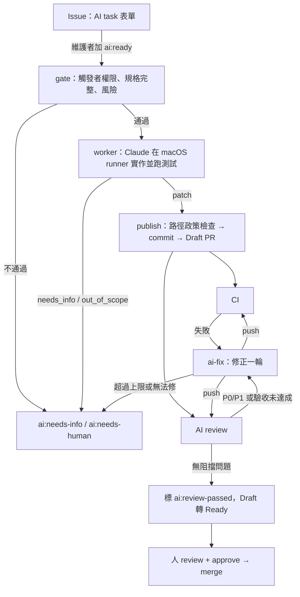

# AI-DLC：issue → PR → 測試 → review 自動化

用 GitHub Actions 加 [`anthropics/claude-code-action`](https://github.com/anthropics/claude-code-action) 跑「issue 到 PR」的開發迴圈。設計依循 AI-DLC 研究草稿的建議：

- issue 是可驗收的規格；
- 實作和發佈分開，權限分離；
- CI 與獨立的 AI review 兩道檢查；
- 修正迴圈有次數上限；
- **合併一律由人決定**。

## 流程

| Workflow | 觸發 | 作用 |
|---|---|---|
| `ai-implement.yml` | issue 加上 `ai:ready`，或手動 dispatch | issue → Draft PR（`ai/issue-<N>` 分支） |
| `ai-review.yml` | PR opened / synchronize / reopened / ready_for_review | 對當前 head SHA 做獨立 review，留一則 PR comment；AI PR 會接著路由到 fix 或轉 Ready |
| `ai-fix.yml` | AI review 有阻擋問題（由 review dispatch），或 `ai/*` PR 的 CI 失敗 | 修正一輪，commit 帶 `AI-Fix-Attempt: N` |
| `ci.yml` 的 `AI-DLC scripts` job | 每個 PR | `.github/ai/ai_dlc.py` 的單元測試 |

AI review 也會跑人開的 PR（同 repo、非 draft），但只留 comment，不會啟動修正。

## 角色與權限

每個 workflow 都拆成幾個 job，各 job 只拿需要的權限：

| Job | GitHub token | Anthropic key | 會執行 repo 程式碼 |
|---|---|---|---|
| gate | issues/PR 寫入（只動標籤與留言） | 無 | 否 |
| worker（Claude） | **唯讀** | 有 | 是（cargo / pnpm） |
| publish | contents + PR 寫入 | **無** | 否：只用 `git apply`，hooks 停用 |
| report | issues/PR 寫入 | 無 | 否 |

- worker 不能 push、不能開 PR、不能留言，只產出 patch 和結構化結果（`.github/ai/schemas/*.json`）。
- publish 在套用 patch **之前**，先用 base 版本的 `.github/ai/ai_dlc.py` 檢查路徑政策：
  - **禁止**：`.github/`、`.claude/`、`CLAUDE.md`、`AGENTS.md`、`signing/`、entitlements、provisioning profile、release／App Store 設定與腳本、`deny.toml`、`rust-toolchain.toml`、`.cargo/`、`.npmrc`、`LICENSE`、`fixtures/traces/`、`docs/spike-report.md`、`docs/adr/`；也不收 binary、symlink、submodule。碰到任何一個就整個 patch 拒絕。比對不分大小寫。
  - **敏感**：依賴清單、`build.rs`、`tauri.conf.json`、`capabilities/`、`tools/`、`assets/sounds/`、偵測參數與 config 原始碼、隱私政策、網站。可以改，但 PR 會標 `ai:sensitive` 並列出這些檔案。
  - **大小上限**：預設 40 個檔案、2000 行。
- AI patch 改不到 `.github/`，所以 AI PR 上執行的 workflow、prompt 與政策腳本都是人合併進來的版本。Reviewer 的指引從 base branch 讀（`git show origin/main:.github/ai/review.md`）。claude-code-action 在 PR 事件上也會把 `CLAUDE.md` 和 `.claude/` 還原成 base 版本。
- issue 和 PR 內文都當成資料，不當成指令。只有 write 以上權限的人加 `ai:ready` 才會啟動 worker，而且 worker 只讀 issue 內文、不讀留言。
- Fork 的 PR 拿不到 secrets，AI review 與 fix 都會跳過。
- worker 設了 `CLAUDE_CODE_SUBPROCESS_ENV_SCRUB=1`，盡量讓 Claude 執行的指令讀不到 API key。這只是縱深防禦，不是保證。也因為這樣，worker 不呼叫 GitHub API：issue、PR、diff 和 CI log 都由 workflow 事先抓成檔案交給它。

## 標籤

| 標籤 | 意義 |
|---|---|
| `ai:triage` | 用 AI task 表單開的 issue，等維護者看規格 |
| `ai:ready` | 維護者同意交給 AI（**這就是啟動開關**）；gate 會把它拿掉 |
| `ai:in-progress` | worker 執行中 |
| `ai:needs-info` | 驗收條件不足；補完 issue 後重新加 `ai:ready` |
| `ai:needs-human` | 自動化停止：風險 High、patch 被拒、修正次數用完、CI 屬於 flaky/infra、或執行失敗 |
| `ai:pr-open` | 已開 Draft PR |
| `ai:generated` | AI 寫的 PR |
| `ai:sensitive` | AI PR 碰到敏感路徑 |
| `ai:review-passed` | AI review 在目前 head 沒有阻擋問題（新 push 後若 review 不過會拿掉） |

標籤由 gate 自動建立；也可以先手動執行 `GH_REPO=kaija/spank .github/ai/ensure-labels.sh`。

## 一次性設定

1. **Claude 認證**（二選一）：在 repo secrets 加 `ANTHROPIC_API_KEY`，或加 `CLAUDE_CODE_OAUTH_TOKEN`（在本機執行 `claude setup-token` 取得）。
2. **GitHub App（建議設定）**：用 `GITHUB_TOKEN` 建立或 push 的 PR，其 CI 與 AI review 需要有人在 Actions 頁手動 approve，修正迴圈會卡在那裡。改用 App token 就能正常觸發。
   - 建一個 GitHub App，權限給 Contents、Pull requests、Issues 的 Read & write（Metadata 唯讀）。不要給 Workflows。
   - 只安裝在 `kaija/spank`。
   - Repo variables：`AI_APP_CLIENT_ID`（App 的 Client ID）、`AI_APP_BOT_LOGIN`（例如 `spank-ai[bot]`，讓 claude-code-action 接受這個 bot 觸發的 review / fix）。
   - Repo secret：`AI_APP_PRIVATE_KEY`（App 的私鑰 PEM）。
3. **不用 App 的替代方案**：在 Settings › Actions › General 打開 *Allow GitHub Actions to create and approve pull requests*，每輪 CI / review 都要手動 approve。
4. **Branch ruleset（main）**：
   - 必須透過 PR。
   - 至少 1 個 approval，有新 push 時撤銷舊 approval。
   - Required checks：`Build & test (macOS)`、`Dependency policy (cargo-deny)`、`AI-DLC scripts`。
   - 禁止 force push。
   - App 與 `github-actions` 都不能 bypass。

   AI review 只是 comment，不是 required check，也不會 approve。

## 可調整的 repo variables

| Variable | 預設 | 說明 |
|---|---|---|
| `AI_MODEL` | action 預設 | worker / fixer 的模型，例如 `claude-opus-5-5` |
| `AI_REVIEW_MODEL` | action 預設 | reviewer 的模型 |
| `AI_MAX_TURNS` | 150 | worker / fixer 的 turn 上限；真正的硬上限是 job 的 90 分鐘 timeout |
| `AI_REVIEW_MAX_TURNS` | 60 | reviewer 的 turn 上限 |
| `AI_MAX_FIX_ATTEMPTS` | 2 | 每個 PR 最多自動修正幾輪（以 commit trailer 計數） |
| `AI_MAX_FILES` / `AI_MAX_LINES` | 40 / 2000 | patch 大小上限 |
| `AI_REVIEW` | （開） | 設成 `off` 就停用 AI review |

## 使用方式

1. 用 **AI task** 表單開 issue：寫清楚問題、驗收條件、範圍、驗證指令，並選擇風險等級。
2. 看過規格後加上 `ai:ready`。也可以從 Actions › AI implement › Run workflow 輸入 issue 編號。
3. 等 Draft PR 出現（issue 上會有連結），再看 CI 和 AI review 的結果。
4. AI review 有 P0/P1 時，或 CI 失敗時，會自動修正，最多 `AI_MAX_FIX_ATTEMPTS` 輪；fixer 不同意的 finding 會附理由列在 fix comment。
5. 出現 `ai:review-passed` 且 PR 轉為 Ready 後，由人 review、approve、merge。
6. 出現 `ai:needs-human` 時改由人接手：可以直接在分支上 push。加了這個標籤後 fix 迴圈不會再動這個 PR；拿掉標籤，下一次 CI 失敗或 review 有阻擋問題時就會恢復（修正次數仍照 commit trailer 累計）。

想重來：刪掉 `ai/issue-<N>` 分支（必要時先關 PR），再重新加 `ai:ready`。

注意：`issues` 和 `workflow_run` 觸發的 workflow 只會用 default branch 上的版本，所以這些 workflow 要合併進 main 之後才會生效。

## 已知限制

- **硬體行為測不到**：CI runner 沒有 SPU 感測器。凡是需要實測的改動，例如門檻值、`spike-report` 參數、新的 trace，worker 都應回 `out_of_scope`。
- **review 沒有 findings 不代表沒有 bug**。AI review 只是多一個檢查來源，取代不了人和 required checks。
- **base 前進造成的衝突不會自動處理**：沒有 webhook 能可靠觸發，需要人 rebase 或 merge main。
- **worker 回報的驗證結果是自述**：PR 上的 CI 才是獨立結果。
- **成本**：worker 與 fixer 跑在 macOS runner（公開 repo 不計費）；模型費用依 token 計算。AI review 在人開的 PR 上也是每次 push 都跑一次，不需要時把 `AI_REVIEW` 設成 `off`。建議先在少量低風險 issue 上試跑，記錄 lead time、人工時間、修正輪數、revert 數，再決定是否放寬。
- **版本固定**：`claude-code-action` 與 `create-github-app-token` 都以 commit SHA 固定。升級時要對照該版的 `action.yml`，並先在一兩個 issue 上驗證。
