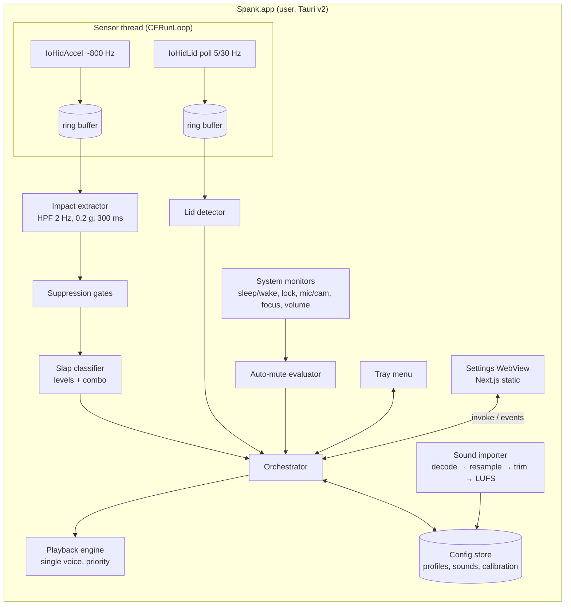
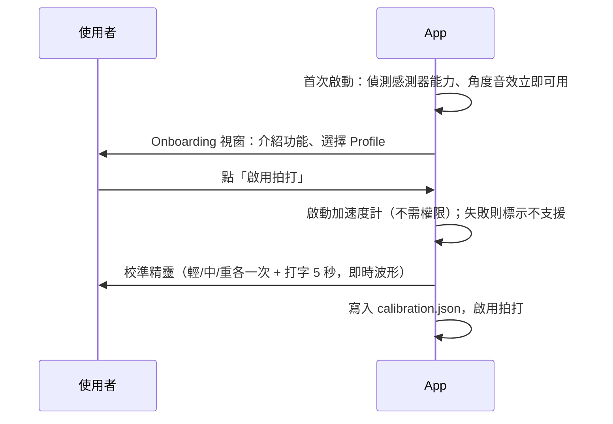

# spank — 設計文件（Phase 1）

> 代號 `spank`；正式產品名稱待定（ADR-0012）。決策依據見 [`docs/adr/`](adr/README.md)。

## 1. 需求摘要

| # | 需求 | 對應 ADR |
|---|------|---------|
| R1 | 螢幕開合時依角度事件播放音效（打開 / 闔上 / 開啟中） | 0005, 0015 |
| R2 | 拍打電腦時依力道分級播放哀叫，支援連擊 | 0006, 0014 |
| R3 | 以 Profile 依情境設定音效；自動靜音（開會、專注、安靜時段、系統靜音） | 0007 |
| R4 | 使用者上傳音效（正規化、≤10 s、≤5 MB） | 0008 |
| R5 | 內建 3 個 Profile（合成音效 CC0，「經典」開合音效為作者以 ElevenLabs 產生）；`.spankpack` 匯入匯出；下載為 Phase 2 | 0008, 0009 |
| R6 | Rust 實作、低功耗（best effort） | 0004, 0013 |
| R7 | 只在選單列常駐、關閉視窗縮到 tray、登入時啟動 | 0004 |
| NFR | Apple Silicon、macOS 14+、DMG 發佈、無遙測、zh-Hant/en、覆蓋率 ≥ 80% | 0001, 0002, 0010, 0011 |

## 2. 系統架構



### 2.1 程序與權限

單一程序 `Spank.app`（Tauri），一般使用者權限，不需 root、不需管理員密碼（ADR-0014，Spike S2 證實）。

| Thread | 責任 |
|--------|------|
| Main（AppKit / Tauri） | Tray、視窗、系統通知（sleep/wake、lock） |
| Sensor | 自己的 CFRunLoop：加速度計 input-report callback、角度 feature-report 輪詢；callback 只寫 ring buffer，絕不 panic |
| Core（tokio current-thread） | 特徵擷取、抑制、分級、lid 狀態機、auto-mute、orchestrator |
| Audio（cpal） | 播放 callback |

備案：若未來 macOS 收緊 SPU property 權限，回到 ADR-0003 的 root helper 架構（`ImpactCandidate` 介面已預留，可直接跨程序傳送）。

## 3. Repo 結構（Cargo workspace + pnpm）

```
spank/
├── Cargo.toml                 # workspace
├── crates/
│   ├── spank-core/            # 純邏輯，無 OS 依賴：事件、Profile、偵測器、規則
│   ├── spank-sensors/         # SensorSource traits、IoHidLid、IoHidAccel、TraceReplay、trace 格式
│   ├── spank-audio/           # importer（symphonia/rubato/ebur128）、playback（cpal）
│   ├── spank-sysmon/          # sleep/wake、lock、mic/cam in-use、focus、系統音量（objc2 / coreaudio）
│   └── spank-pack/            # .spankpack 讀寫與驗證
├── apps/
│   └── desktop/               # Next.js 專案根目錄（src/app、out/ 靜態匯出）+ src-tauri/（Tauri v2 Rust）
├── tools/
│   ├── lid-probe/             # Spike S1
│   ├── accel-probe/           # Spike S2
│   ├── audio-probe/           # Spike S5
│   ├── focus-probe/           # Spike S4
│   └── trace-recorder/        # 錄製 + 標註 trace
├── fixtures/traces/           # NDJSON traces（Git LFS）
├── assets/sounds/             # 內建音效（builtin/）、錄音原檔（source/）+ SOUNDS_LICENSE.md
├── docs/                      # ADR、design、tasks、spike 報告、release checklist
└── .github/workflows/         # ci.yml、release.yml
```

## 4. 核心領域模型（`spank-core`）

```rust
pub enum EventKind {
    LidOpened, LidClosing, LidOverbent,
    SlapLight, SlapMedium, SlapHard, SlapCombo,
}

pub struct TriggerEvent { kind: EventKind, ts: Instant, meta: EventMeta } // meta: angle / peak_g / combo_n

pub struct Profile {
    id: ProfileId, name: String, builtin: bool, volume: f32,
    mapping: HashMap<EventKind, EventBinding>,
}
pub struct EventBinding { enabled: bool, sounds: Vec<SoundId> }

pub struct LidConfig  { open_min: f32, close_threshold: f32, opening_start: f32, overbend_threshold: f32,
                        hysteresis: f32, cooldown: Duration }
pub struct SlapConfig { light: f32, medium: f32, hard: f32, combo_window: Duration,
                        combo_count: u8, cooldown: Duration, precise_typing: bool }
pub struct MuteRules  { meeting: bool, focus: bool, quiet_hours: Vec<TimeRange>, follow_system: bool }
```

### 4.1 Lid detector（狀態機）

```
            angle < close_th            angle > close_th + hyst
  ┌───────┐ ─────────────────► ┌───────┐ ──────────────────────► ┌───────┐
  │ Armed │   emit LidClosing  │ Low   │                         │ Armed │
  └───────┘                    └───────┘                         └───────┘
  on Wake: if angle > open_min → emit LidOpened
  opening()（ADR-0015）：opening_start ≤ angle ≤ over_th 且正在往上（累積 ≥ 2°，300 ms 內持續上升）
    → Orchestrator 播放 LidOverbent；停下／往下 → 淡出並記住位置；再往上 → 續播；每次打開播一遍，
      角度低於 opening_start 才重新開始
  每種事件各自 cooldown；角度變化率 |dθ/dt| > 5°/s 時標記 "lid_moving"（供 suppression 使用）
```

### 4.2 Slap 管線

1. **Impact extractor**（`spank-core::impact`，Core thread，從 ring buffer 批次取資料，~50 ms 一批）：
   `a = (x,y,z)` → 各軸一階高通（去重力，fc = 2 Hz）→ `m = |a_hp|`
   → `m > max(trigger_g, 12 × noise_floor)`（`trigger_g` 0.15 g，noise floor 為 1 s EMA，接受衝擊後凍結 250 ms）時開窗 80 ms
   → 平均頻率 ≥ 16 Hz 且不是 rebound（250 ms 內峰值 < 0.45 × 前一下）才輸出
   `ImpactCandidate { at_ms, peak_g, energy, duration_ms, mean_freq_hz }`；refractory 150 ms（T23，見 spike-report）。
2. **App suppression gates**（依序，任一成立即丟棄）：
   `lid_moving(+500ms)` → `self_playing(+200ms)` → `precise_typing(+300ms)`（打字的訊號特徵已在第 1 步的噪音門檻處理）。
3. **Classifier**：`peak_g` 對照校準門檻 → Light / Medium / Hard；
   `combo_window`（5 s）內第 `combo_count`（3）次以上 → `SlapCombo(n)`。不另設同級 cooldown。

### 4.3 Orchestrator

`spank-core::Orchestrator`：純邏輯，由 runtime 餵入 lid 樣本、accel 批次、`SysSignal`、設定變更，回傳 `Output`
（感測器啟停、`Fired { event, result }`、`MuteChanged`、`StopSound`）；播放經 `Player` trait（測試用假的）。
感測器只在「醒著 + 未鎖定 + 未暫停」時運作（accel 另需啟用拍打）；喚醒後即使鎖定也讀一次角度觸發 `LidOpened`。
Combo 沒有綁音效時退回該次力道分級的音效（優先權仍為 Combo）。

```
event → muted? (AutoMute) ─yes→ drop (log)
      └no→ active profile binding enabled? ─no→ drop
           └yes→ pick random sound (避免連續重複) → Playback.request(priority, sound, volume)
```

## 5. Sensor thread 與資料流

- Sensor thread 啟動自己的 `CFRunLoop`：
  - 加速度計：`IOHIDDeviceRegisterInputReportCallback`；callback 解析 22-byte report → `AccelSample` 推進 SPSC ring buffer（容量 ~2 s）。
  - 角度：`CFRunLoopTimer` 輪詢 feature report（5 Hz；角度變化時升到 30 Hz，2 s 無變化降回）→ `LidSample`。
- Core thread 每 ~50 ms 取一批資料處理（ADR-0013：不逐筆喚醒）。
- 控制：`SensorCommand { StartAccel, StopAccel, StartLid, StopLid, CalibrationTap(on/off) }` 經 channel 傳給 sensor thread。
- 停止加速度計時把 `SensorPropertyReportingState` / `PowerState` / `ReportInterval` 設回 0；啟動時先重設一次（處理上次 crash 殘留）。
- Calibration：校準期間額外把降採樣（50 Hz）的 magnitude 送給 UI 顯示即時波形。

## 6. 感測器存取（`spank-sensors`）

| 感測器 | 位置 | 讀法（Spike 已驗證，見 spike-report） |
|--------|------|-------------------|
| Lid angle | HID `05AC:8104`, page `0x20`, usage `0x8A` | 輪詢 `IOHIDDeviceGetReport(kIOHIDReportTypeFeature, id=1)` → 3 bytes `[01, lo, hi]`，u16 LE = 角度（度），~0.7 ms／次。Input report 推送固定 ~1 Hz，不使用 |
| Accelerometer | HID `05AC:8104`, page `0xFF00`, usage `3` | 對 `AppleSPUHIDDriver` 設 `SensorPropertyReportingState=1`、`SensorPropertyPowerState=1`、`ReportInterval`（µs）（一般權限即可）→ input report callback，~796 Hz；22 bytes，x/y/z 為 int32 LE @ offset 6/10/14，÷65536 = g |

以 `io-kit-sys` + `core-foundation` FFI 實作，FFI 層盡量薄，解析邏輯放純函式以便測試。

## 7. 系統監控（`spank-sysmon`）

| 訊號 | API |
|------|-----|
| 睡眠 / 喚醒 | `NSWorkspaceWillSleepNotification` / `DidWakeNotification` |
| 螢幕鎖定 | `NSDistributedNotificationCenter` `com.apple.screenIsLocked` / `screenIsUnlocked` |
| 麥克風使用中 | CoreAudio process 物件（macOS 14+）：任一其他程序 `kAudioProcessPropertyIsRunningInput` + property listener（排除本 App） |
| 相機使用中 | CoreMediaIO：`kCMIODevicePropertyDeviceIsRunningSomewhere` |
| 專注模式 | `INFocusStatusCenter.defaultCenter.focusStatus.isFocused`（需授權；沒有變更通知，每 5 s 輪詢） |
| 系統音量 / 靜音 | CoreAudio default output `kAudioDevicePropertyMute` / `VolumeScalar` |
| 鍵盤輸入（精準模式） | `IOHIDManager` keyboard/trackpad（需 Input Monitoring） |

全部輸出為 `SysSignal` 變化事件，由 `AutoMute` 評估。

## 8. 音訊（`spank-audio`）

- **Importer**：`symphonia` decode → `rubato` resample 48 kHz → 去前導靜音（-50 dBFS）→ `ebur128` 正規化 -16 LUFS、true peak ≤ -1 dBTP → WAV。
- **Library**：`sounds/index.json` + `sounds/<uuid>.wav`。
- **Playback**：啟動時建立 `cpal` output stream 並保持 paused（Spike S5：常駐輸出讓 coreaudiod 吃 ~12% CPU）；觸發時 `play()`（20–40 ms），播完 500 ms 後 `pause()`。
  單聲部 mixer：`request(priority, buffer, gain)`；高優先權 → 50 ms fade-out 現有 → 播新的。
- 預載：切換 Profile 時把該 Profile 所有音效解碼進記憶體（`SoundBank`，總量上限 ~ 30 MB）。
  Mixer 即時做取樣率（線性內插）與聲道轉換，輸出裝置改變時不需重新載入。實測 pause → play 中位數 40 ms。

## 9. 設定儲存

`~/Library/Application Support/dev.spank.app/`

```
config.json         # 全域：active_profile、app_volume、lid/slap/mute 設定、onboarding 狀態、updater 設定
profiles/<id>.json  # 使用者 Profile（內建 Profile 隨 bundle，唯讀）
sounds/index.json   # 音效庫索引
sounds/<uuid>.wav
calibration.json    # 拍打校準結果
```

- 所有寫入採 atomic write（tmp + rename），schema 帶 `version` 欄位以便 migration。

## 10. UI（Tauri + Next.js）

### 10.1 Tray 選單

```
● Spank — 運作中 / 已靜音（開會中）
─────────────
暫停 / 繼續
Profile ▸  ✓ 毀滅 / 哀哀叫 / 經典 / …自訂
試聽 ▸     打開 / 闔上 / 掰過頭 / 輕拍 / 重拍 / 連擊
─────────────
設定…
結束
```

### 10.2 設定視窗頁面

1. **Profiles**：清單 + 事件對應編輯（每事件拖放音效、試聽、啟用開關、Profile 音量）。
2. **音效庫**：拖放 / 選檔上傳、波形預覽、改名、刪除、匯入 / 匯出 `.spankpack`。
3. **感測器**：即時角度顯示、角度門檻滑桿、拍打靈敏度、重新校準、精準打字模式開關、感測器能力狀態。
4. **自動靜音**：四條規則開關、安靜時段編輯。
5. **一般**：登入時啟動、App 音量、語言、更新、複製診斷資訊。
6. **Onboarding / 校準精靈**（首次啟動與啟用拍打時）。

### 10.3 前後端介面（Tauri commands，型別由 ts-rs 產生到 `apps/desktop/src/bindings`）

實作在 `apps/desktop/src-tauri/src/commands.rs`；前端經 `src/backend/`（`Backend` 介面，App 內為 `tauriBackend`，瀏覽器預覽與測試為 `createMockBackend`）呼叫。

- 狀態 / 設定：`app_info`、`get_state`（`RuntimeState`）、`get_config`、`set_paused`、`set_mute_rules`、`set_slap_enabled`、`set_lid_config`、`set_slap_config`、`set_app_volume`、`set_language`、`set_launch_at_login`、`set_auto_check_updates`
- Profiles：`list_profiles`、`create_profile`、`duplicate_profile`、`save_profile`、`rename_profile`、`delete_profile`、`set_active_profile`
- 音效庫：`list_sounds`、`sound_peaks`（波形縮圖）、`import_sound(path)`（`ImportOutcome`）、`rename_sound`、`delete_sound`（同時從自訂 Profile 移除）、`preview_sound`、`stop_preview`、`preview_event`、`reveal_sound`
- 音效包：`import_pack`（`PackImported`）、`export_pack`
- 專注模式：`request_focus_authorization`、`open_focus_settings`
- Onboarding / 校準（T36）：`open_calibration`（開校準視窗）、`start_calibration`、`calibration_step(step, reset)`、`cancel_calibration`、`finish_calibration`（寫 `calibration.json`、套用門檻並啟用拍打）、`get_calibration`、`complete_onboarding`（關閉精靈視窗）
- 感測器頁：`set_accel_monitor(on)`（即時波形）；能力狀態在 `RuntimeState.caps` / `input_access`
- 精準打字（T39）：`request_input_monitoring`、`open_input_monitoring_settings`
- 一般頁（T38）：`diagnostics`、`copy_diagnostics`、`open_log_folder`
- 更新（T41）：`check_for_updates`（`{current, available}`）、`install_update`（下載、安裝、重新啟動）

Events：`engine_state`（`RuntimeState`，任何狀態變化）、`trigger_fired`（`FiredEvent`）、`config_changed`（`AppConfig`）、`profiles_changed`、`library_changed`、
`calibration`（`CalibrationProgress`）、`accel_level`（每 ~50 ms 一個 g 值，只在校準中或感測器頁開著時送）、`update_progress`（0–1）。

視窗：`settings`（設定）與 `onboarding`（首次啟動的 `onboarding/` 或只校準的 `calibrate/`，560 × 440）；任一視窗開著時顯示 Dock 圖示。

內建音效與 Profile 以 `.spankpack` 放在 bundle 資源 `builtin/`（來源 `assets/sounds/builtin/`），啟動時載入成唯讀 Profile（`builtin.*`）與記憶體內音效。

## 11. Onboarding 流程



## 12. 建置與發佈

- **CI（`ci.yml`）**：`macos-latest`：`cargo fmt --check`、`clippy -D warnings`、`cargo test`（含 trace 重播）、
  `cargo llvm-cov`（≥80%）、`pnpm lint && pnpm test`、`cargo deny`（依賴掃描）。
- **Release（`release.yml`，tag `v*`）**：只建置 `aarch64-apple-darwin`（不出 universal，ADR-0001）；
  `codesign`（Developer ID Application, hardened runtime, entitlements）→ `notarytool submit --wait` → `stapler staple`
  → updater 用的 `.app.tar.gz` + `.sig` + `latest.json` → DMG（簽章、公證、staple）→ 草稿 GitHub Release（`tools/release.sh`，見 `docs/release.md`）。
- Entitlements：App 不 sandbox、啟用 Hardened Runtime；不需特殊 entitlement 存取 HID（待 T09 在簽章 .app 內確認）。
- 版本：SemVer。

## 13. 風險與待驗證（Spike）

| ID | 假設 | 狀態 | 若失敗 |
|----|------|------|--------|
| S1 | 角度感測器可不靠 root 讀取 | ✅ 已驗證：feature report 輪詢 | — |
| S2 | 加速度計格式 / 權限 / 可區分拍打 | ✅ 已驗證：不需 root、~796 Hz、0.2 g 門檻 | — |
| S3 | 簽章 + Hardened Runtime 的 .app 內同樣可讀兩個感測器 | ✅ T09 | — |
| S4 | `INFocusStatusCenter` 能回報專注狀態 | ✅ 需 Developer ID + provisioning profile | 開發版標示「需正式簽章版本」 |
| S5 | cpal output stream 閒置耗電 | ✅ 常駐太耗電 → paused + 按需 play | — |
| R1 | 未來 macOS 收緊 SPU property 權限 | 持續觀察 | 啟用 ADR-0003 helper 備案 |
| R2 | 其他機型（M1–M3、MacBook Pro）行為不同 | 待社群 trace | capability detection 關閉功能 |
