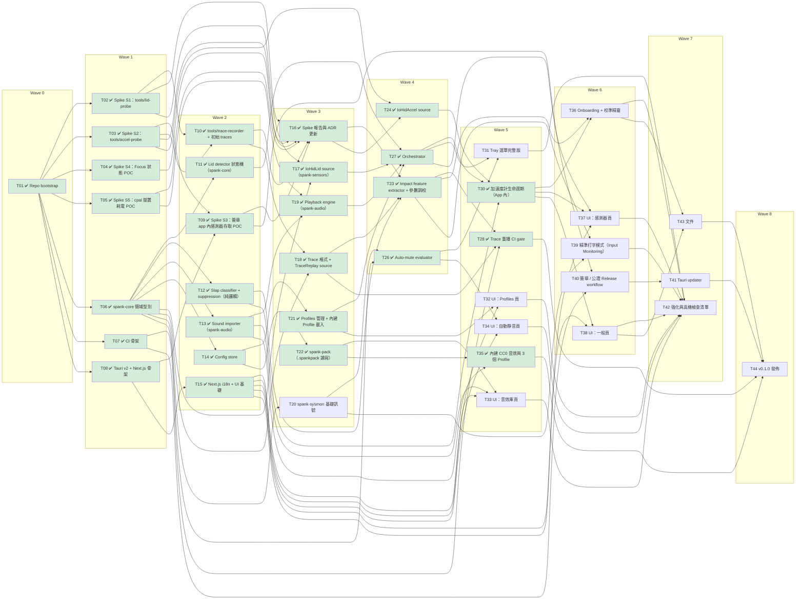

# spank — 任務清單（Phase 1，依 Wave 執行）

> 規則：**同一個 Wave 內的任務彼此沒有依賴，可以平行執行**；每個任務只依賴更早 Wave 的任務。
> 一個 Wave 全部完成（或其依賴的任務完成）後即可開始下一個 Wave。
> ⛳ = Gate：結果可能修改 ADR / 設計，後續任務開始前要先檢查。

## 開發狀態（2026-10-25）

- **進度**：Wave 0–7 實作完成，只剩 T44（決定正式名稱與 bundle ID 後發佈）。已合併到 `main` 並推上 GitHub。
- **App 現況**：選單列 App：螢幕開合音效、拍打（校準後啟用）、自動靜音、精準打字模式、Tray 選單、五個設定頁、首次啟動 Onboarding 與校準精靈、內建三個 Profile、每日檢查更新、log 檔（`~/Library/Logs/dev.spank.app/spank.log`）。
- **待使用者手動驗證**（🟡）：統一整理在 [`docs/release-checklist.md`](release-checklist.md) 第 6 節（T20、T31–T34、T36–T39、T41），以及第 2–5 節未勾選的項目；T43 文件待審閱。
- **發佈前要準備**：`docs/release.md` 的 Secrets（含 updater 私鑰 `TAURI_SIGNING_PRIVATE_KEY`）；ADR-0012 決定正式名稱與 bundle ID（會牽動 provisioning profile 與 entitlements）。
- **已知限制**：內建人聲是合成的卡通音；T23 參數只用一台 M4 Air、一位使用者的 trace 調過；nightly `cargo fuzz` 尚未跑過（已跑 stable 替代測試）。

## 總覽

| Wave | 主題 | 任務（同 Wave 可平行） |
|------|------|------|
| 0 | Repo 初始化 | T01 ✅ |
| 1 | Spike + 基礎骨架 | T02 ✅ T03 ✅ T04 ✅ T05 ✅ T06 ✅ T07 ✅ T08 ✅ |
| 2 | Spike 收尾 + 純邏輯模組 | T09 ✅ T10 ✅ T11 ✅ T12 ✅ T13 ✅ T14 ✅ T15 ✅ |
| 3 | ⛳ Spike Gate + 平台層 | T16 ✅ T17 ✅ T18 ✅ T19 ✅ T20 T21 ✅ T22 ✅ |
| 4 | 偵測 / 規則 / Orchestrator | T23 ✅ T24 ✅ T26 ✅ T27 ✅ |
| 5 | 感測整合、UI 頁面、CI gate | T28 ✅ T30 ✅ T31 T32 T33 T34 T35 ✅ |
| 6 | Onboarding、進階功能、發佈管線 | T36 T37 T38 T39 T40 |
| 7 | 更新、強化、文件 | T41 T42 T43 |
| 8 | 發佈 | T44 |

> T25（spank-ipc）、T29（spank-helper）已依 ADR-0014 移除（加速度計不需 root）。

**Critical path**：T01 → T03 → T09 → T16 → T24 → T30 → T36 → T43 → T44

### 依賴表

| 任務 | Wave | 依賴 |
|------|------|------|
| T01 ✅ Repo bootstrap | 0 | — |
| T02 ✅ Spike S1：tools/lid-probe | 1 | T01 |
| T03 ✅ Spike S2：tools/accel-probe | 1 | T01 |
| T04 ✅ Spike S4：Focus 狀態 POC | 1 | T01 |
| T05 ✅ Spike S5：cpal 閒置耗電 POC | 1 | T01 |
| T06 ✅ spank-core 領域型別 | 1 | T01 |
| T07 ✅ CI 骨架 | 1 | T01 |
| T08 ✅ Tauri v2 + Next.js 骨架 | 1 | T01 |
| T09 ✅ Spike S3：簽章 .app 內感測器存取 POC | 2 | T03, T08 |
| T10 ✅ tools/trace-recorder + 初始 traces | 2 | T02, T03 |
| T11 ✅ Lid detector 狀態機（spank-core） | 2 | T06 |
| T12 ✅ Slap classifier + suppression（純邏輯） | 2 | T06 |
| T13 ✅ Sound importer（spank-audio） | 2 | T06 |
| T14 ✅ Config store | 2 | T06 |
| T15 ✅ Next.js i18n + UI 基礎 | 2 | T08 |
| T16 ✅ Spike 報告與 ADR 更新 | 3 | T02, T03, T04, T05, T09, T10 |
| T17 ✅ IoHidLid source（spank-sensors） | 3 | T02, T06 |
| T18 ✅ Trace 格式 + TraceReplay source | 3 | T06, T10 |
| T19 ✅ Playback engine（spank-audio） | 3 | T05, T13 |
| T20 spank-sysmon 基礎訊號 | 3 | T06 |
| T21 ✅ Profiles 管理 + 內建 Profile 載入 | 3 | T14 |
| T22 ✅ spank-pack（.spankpack 讀寫） | 3 | T14 |
| T23 ✅ Impact feature extractor + 參數調校 | 4 | T12, T16, T18 |
| T24 ✅ IoHidAccel source | 4 | T16, T03 |
| T26 ✅ Auto-mute evaluator | 4 | T20, T06 |
| T27 ✅ Orchestrator | 4 | T11, T17, T19, T21 |
| T28 ✅ Trace 重播 CI gate | 5 | T23, T18, T07 |
| T30 ✅ 加速度計生命週期（App 內） | 5 | T12, T24, T27 |
| T31 Tray 選單完整版 | 5 | T27, T26 |
| T32 UI：Profiles 頁 | 5 | T21, T15 |
| T33 UI：音效庫頁 | 5 | T13, T22, T15 |
| T34 UI：自動靜音頁 | 5 | T26, T15 |
| T35 ✅ 內建 CC0 音效與 3 個 Profile | 5 | T13, T22 |
| T36 Onboarding + 校準精靈 | 6 | T23, T30 |
| T37 UI：感測器頁 | 6 | T27, T30, T15 |
| T38 UI：一般頁 | 6 | T30, T15 |
| T39 精準打字模式（Input Monitoring） | 6 | T23, T20 |
| T40 簽章 / 公證 Release workflow | 6 | T09, T07 |
| T41 Tauri updater | 7 | T40 |
| T42 強化與真機檢查清單 | 7 | T31, T32, T33, T34, T36, T37, T38, T39 |
| T43 文件 | 7 | T36, T38 |
| T44 v0.1.0 發佈 | 8 | T41, T43, T35, T28 |

---

## Wave 0 — Repo 初始化

### T01 Repo bootstrap
- 依賴：—
- 狀態：✅ 完成（2026-10-24）：workspace、LICENSE、README、rust-toolchain、rustfmt、.editorconfig、pre-commit（fmt + clippy）、個人 git 身分
- 內容：`git-user personal`；`.gitignore`（target、node_modules、.next、out、`.claude/worktrees`、`*.trace.ndjson` 大檔走 LFS）；
  `LICENSE`（MIT）；`README.md`；根 `Cargo.toml` workspace；`rust-toolchain.toml`（stable）；`.editorconfig`；pre-commit（fmt/clippy）。
- 完成條件：`cargo build --workspace` 通過（空 workspace + tools）；git author 為個人帳號。

## Wave 1 — Spike + 基礎骨架

### T02 Spike S1：`tools/lid-probe`
- 依賴：T01
- 狀態：✅ 完成（2026-10-24，見 spike-report S1）
- 內容：列出 `05AC:8104` 各 collection；開啟 page `0x20`/usage `0x8A`；嘗試 feature report / input report；一般權限執行；印出角度與時間戳；量測更新頻率、是否主動推送。
- 完成條件：`docs/spike-report.md` S1 段落：可否非 root 讀取、報告格式、建議取樣方式。

### T03 Spike S2：`tools/accel-probe`
- 依賴：T01
- 狀態：✅ 完成（2026-10-24，見 spike-report S2；不需 root → ADR-0014）
- 內容：找 page `0xFF00`/usage `3`；一般權限 vs `sudo` 各試一次（含設定 `SensorPropertyReportingState` 等 property）；dump 原始 report hex；推導 x/y/z offset 與單位；量測取樣率；`--ndjson` 輸出樣本。
- 完成條件：spike report S2 段落：是否需 root、格式、取樣率、靜置雜訊、拍打峰值範例。

### T04 Spike S4：Focus 狀態 POC
- 依賴：T01
- 狀態：✅ 完成（2026-10-24，併 T09）：Focus 狀態需 Communication Notifications provisioning profile，否則 isFocused 恆為 false（見 spike-report S4）
- 內容：Rust + objc2 呼叫 `INFocusStatusCenter`，請求授權並讀 `isFocused`（需在 .app bundle 內執行）。
- 完成條件：spike report S4：可行 / 不可行 + 需要的 Info.plist key。

### T05 Spike S5：cpal 閒置耗電 POC
- 依賴：T01
- 狀態：✅ 完成（2026-10-24）：stream 建立後保持 paused、按需 play（見 spike-report S5）
- 內容：常駐 output stream（輸出靜音）vs 按需開 stream；量測 CPU / 能源影響與首音延遲。
- 完成條件：spike report S5：選定策略。

### T06 `spank-core` 領域型別
- 依賴：T01
- 狀態：✅ 完成（2026-10-24）：20 個單元測試，line coverage 98.7%
- 內容：`EventKind`、`TriggerEvent`、`Profile`、`EventBinding`、`LidConfig`、`SlapConfig`、`MuteRules`、`Priority`；serde；預設值。
- 完成條件：單元測試覆蓋 serde round-trip 與預設值。

### T07 CI 骨架
- 依賴：T01
- 狀態：✅ 完成（2026-10-24）：`.github/workflows/ci.yml` + `deny.toml`；本機 fmt / clippy / test / llvm-cov / cargo-deny 皆通過（尚無 remote，未在 GitHub 上跑過）
- 內容：`.github/workflows/ci.yml`：fmt、clippy `-D warnings`、test、`cargo llvm-cov`（先不設門檻）、`cargo deny`；pnpm lint/test（UI 建好後啟用）。
- 完成條件：PR 上 CI 綠燈。

### T08 Tauri v2 + Next.js 骨架
- 依賴：T01
- 狀態：✅ 完成（2026-10-24）：tray-only 12 MB、Dock 圖示隨設定視窗出現 / 消失（見 spike-report T08）。登入時啟動外掛已註冊，實際啟用交給 T14 / T38
- 內容：`apps/desktop`：Tauri v2、Next.js `output: "export"`、TypeScript、pnpm；tray icon + 基本選單（設定…、結束）；`LSUIElement`；關閉視窗即銷毀 WebView、ActivationPolicy 切換；login item（`tauri-plugin-autostart` 或 SMAppService mainApp）。
- 完成條件：`pnpm tauri dev` 可跑；關閉視窗後 Dock 圖示消失、tray 仍在；閒置記憶體記錄於 spike report。

## Wave 2 — Spike 收尾 + 純邏輯模組

### T09 Spike S3：簽章 .app 內感測器存取 POC
- 依賴：T03、T08
- 狀態：✅ 完成（2026-10-24）：ad-hoc 與 Developer ID 簽章 .app 皆可讀兩個感測器（`tools/run-as-app.sh`）；Focus 見 S4
- 內容：在 T08 的 Tauri App 內（ad-hoc 與 Developer ID 簽章、Hardened Runtime 開啟）重跑 lid 輪詢與加速度計讀取；以 Developer ID + Communication Notifications entitlement 重測 Focus `isFocused`（T04 未完成部分）；從 Finder 雙擊與登入項目啟動各測一次（排除 Terminal 繼承的權限）；確認是否需要任何 entitlement 或 TCC 提示。
- 完成條件：spike report S3；ADR-0014 狀態改為 Accepted（或退回 ADR-0003 helper 備案）。

### T10 `tools/trace-recorder` + 初始 traces
- 依賴：T02、T03
- 狀態：✅ 完成（2026-10-24）：`tools/trace-recorder`、格式 v1（fixtures/traces/README.md）、`fixtures/traces/m4air-v1/` 6 個情境 24 個標註片段
- 內容：同時錄 lid + accel 到 NDJSON（ADR-0010 格式）；鍵盤快捷鍵即時標註；錄製場景：靜置、打字、觸控板、輕/中/重拍、連拍、開合、掰過頭、放桌上、走路攜帶、播放音樂。
- 備註：尚未錄製外接鍵盤情境；其他機型的 trace 待社群提供（T43 CONTRIBUTING）。
- 完成條件：`fixtures/traces/` 至少 10 段標註 trace。

### T11 Lid detector 狀態機（`spank-core`）
- 依賴：T06
- 狀態：✅ 完成（2026-10-24）：`spank-core::lid::LidDetector`，13 個測試，line coverage 100%
- 內容：design §4.1；hysteresis、cooldown、`lid_moving` 旗標、wake 事件處理。
- 完成條件：以合成資料單元測試所有轉換與邊界。

### T12 Slap classifier + suppression（純邏輯）
- 依賴：T06
- 狀態：✅ 完成（2026-10-24）：`spank-core::slap::SlapClassifier`（閘 → 分級 → 連擊），10 個測試
- 內容：design §4.2 第 2–3 步：分級、連擊、cooldown、各 suppression gate（輸入為 `ImpactCandidate` 與 gate 訊號）。
- 完成條件：合成資料單元測試；門檻參數先用 placeholder。

### T13 Sound importer（`spank-audio`）
- 依賴：T06
- 狀態：✅ 完成（2026-10-24）：`spank-audio`（6 種格式、-16 ± 0.5 LUFS、≤ -1 dBTP、>2 聲道混為 mono），11 個測試
- 內容：symphonia decode、rubato resample、去前導靜音、ebur128 正規化、true-peak 限制、長度/大小限制、WAV 輸出、sha256。
- 完成條件：各格式 fixture 測試；輸出響度 -16 ± 0.5 LUFS。

### T14 Config store
- 依賴：T06
- 狀態：✅ 完成（2026-10-24）：`spank-store`（atomic write、毀損檔隔離、schema migration、Profile / 音效索引 / 校準），22 個測試
- 內容：design §9 目錄結構；atomic write；schema version + migration 框架；sound library index CRUD。
- 完成條件：單元測試（temp dir）；毀損檔案時回復預設並備份。

### T15 Next.js i18n + UI 基礎
- 依賴：T08
- 狀態：✅ 完成（2026-10-24）：next-intl（zh-Hant / en）、設定視窗外框（overlay 標題列）、Inter 本地字型、Vitest、ts-rs 產生 TS 型別（取代 tauri-specta，後者仍為 RC）
- 內容：`next-intl`（zh-Hant / en，跟隨系統語言）；layout、導覽、設計 token；`tauri-specta` 型別產生流程。
- 完成條件：切換系統語言 UI 跟著變；Vitest 跑得起來。

## Wave 3 — ⛳ Spike Gate + 平台層

### T16 ⛳ Spike 報告與 ADR 更新
- 依賴：T02、T03、T04、T05、T09、T10
- 狀態：✅ 完成（2026-10-24）：S1–S5、T09、T10 結果已寫入 spike-report 與 ADR-0003/0005/0006/0007/0008/0014；決策：不需 root、Focus 用 provisioning profile、拍桌子視同拍打
- 內容：彙整 `docs/spike-report.md`；更新 ADR-0003（Accepted 或 Superseded）、ADR-0005 取樣方式、ADR-0006 參數初值、ADR-0007 Focus 可行性；必要時調整本任務清單。
- 完成條件：使用者審閱同意。

### T17 `IoHidLid` source（`spank-sensors`）
- 依賴：T02、T06
- 狀態：✅ 完成（2026-10-24）：`spank-sensors`（`LidSource`、`IoHidLid` feature report 輪詢、`LidPollSchedule` 5/30 Hz、`capabilities()`）；真機 `examples/sensor-check` 讀取 0.73 ms／次；睡眠時停止由 Orchestrator 下 `StopLid`
- 內容：依 S1 結果實作 `LidSource`；capability detection；sleep 時停止。
- 完成條件：真機手動驗證；解析函式單元測試。

### T18 Trace 格式 + `TraceReplay` source
- 依賴：T06、T10
- 狀態：✅ 完成（2026-10-24）：`spank-sensors::trace`（v1 讀寫、labels）、`TraceReplay`（`LidSource` / `AccelSource`、依時間合併、50 ms 批次、`with_speed` 加速重播）；讀取 `m4air-v1` 全部 6 段 trace 重播測試
- 內容：NDJSON reader/writer、labels；`TraceReplay` 實作 `LidSource` / `AccelSource`，可加速重播。
- 完成條件：讀取 T10 的 traces 並重播測試。

### T19 Playback engine（`spank-audio`）
- 依賴：T05、T13
- 狀態：✅ 完成（2026-10-24）：`spank-audio` `Mixer`（單聲部、優先權中斷 + 50 ms fade-out、即時重新取樣與聲道對應）、`SoundBank`（預載、30 MB 上限）、`AudioPlayer`（cpal stream 常駐 paused、播完 500 ms 後 pause、`PlaybackStatus` 供播放閘）；真機 `examples/playback-latency`：pause → play 中位數 40 ms（< 50 ms）
- 內容：cpal 輸出、單聲部 mixer、優先權中斷 + 50 ms fade-out、預載、gain 計算、`self_playing` 訊號輸出。
- 完成條件：單元測試（mixer 邏輯以假 output）；真機延遲 < 50 ms。

### T20 `spank-sysmon` 基礎訊號
- 依賴：T06
- 狀態：🟡 實作完成（2026-10-24）：`spank-sysmon` `SysMonitor`（NSWorkspace 睡眠／喚醒、distributed 鎖定通知、CoreAudio process 物件偵測麥克風（排除本 App）、CoreMediaIO 相機、預設輸出 mute／volume、Focus 每 5 s 輪詢），全部以 listener 為主；真機已確認初始值正確，**逐項切換驗證待使用者跑 `cargo run -p spank-sysmon --example sysmon-watch`**
- 內容：sleep/wake、screen lock、mic in-use、camera in-use、系統音量/靜音（以 listener 為主，避免輪詢）。
- 完成條件：真機手動驗證每個訊號；輸出 `SysSignal` 事件流。

### T21 Profiles 管理 + 內建 Profile 載入
- 依賴：T14
- 狀態：✅ 完成（2026-10-24）：`spank-store::Profiles`（內建唯讀 `builtin.*`、從 bundle 目錄載入、建立／複製／改名／刪除、active profile 與 fallback）；`spank-core::SoundPicker`（隨機、不連續重複）
- 內容：Profile CRUD、複製、刪除、內建唯讀、active profile、隨機挑音（避免連續重複）。
- 完成條件：單元測試。

### T22 `spank-pack`（.spankpack 讀寫）
- 依賴：T14
- 狀態：✅ 完成（2026-10-24）：`spank-pack`（manifest v1、路徑穿越／symlink／大小／zip bomb／sha256／WAV 格式驗證、匯入建立 Profile（內容定址 sound id，可重複匯入）、匯出、`PackSource` / `LocalFile`）；`fuzz/` cargo-fuzz target（需 nightly，未跑）+ stable 版 3000 次突變測試
- 內容：ADR-0009 manifest schema、驗證（sha256、大小、路徑穿越、zip bomb）、匯入建立 Profile、匯出。
- 完成條件：單元測試 + `cargo fuzz` target。

## Wave 4 — 偵測 / 規則 / Orchestrator

### T23 Impact feature extractor + 參數調校
- 依賴：T12、T16、T18
- 狀態：✅ 完成（2026-10-24）：`spank-core::impact::ImpactExtractor`（高通 → `max(trigger, 12 × noise floor)` 開窗 → 平均頻率 ≥ 16 Hz、rebound 檢查）；預設 trigger 0.15 g、refractory 150 ms（連拍實測間隔 ~200 ms）；`m4air-v1` 23 個人工標註拍打：precision 1.00、recall 1.00（`spank-sensors/tests/slap_traces.rs`，標註在 `fixtures/traces/m4air-v1/expected.json`）。只有一台機器一位使用者，見 spike-report T23
- 內容：design §4.2 第 1 步（高通、noise floor、開窗、特徵）；打字訊號特徵濾波；用 traces 調參數。
  拍桌子視同拍打（ADR-0006），只需排除打字、拿起／放下、走路等非撞擊動作。
- 備註：參數改動（含 ADR-0006 的 trigger 0.2 → 0.15 g、refractory 300 → 150 ms）後要重跑 `cargo test -p spank-sensors --test slap_traces -- --nocapture`；新 trace 要在 `expected.json` 標註拍打起點。
- 完成條件：trace 重播 precision ≥ 0.95、recall ≥ 0.90。

### T24 `IoHidAccel` source
- 依賴：T16、T03
- 狀態：✅ 完成（2026-10-24）：`spank-sensors::IoHidAccel`（獨立 sensor thread + CFRunLoop、property 設定／還原、`reset_accel_properties()` 處理 crash 殘留、callback 只推 `rtrb` SPSC ring buffer、`drain` 批次讀取、`probe` capability 檢查）；真機 798 Hz、0 遺失、停止後 ReportInterval 回到 0。panic hook 還原留給 T30
- 內容：依 S2 結果實作 `AccelSource`：sensor thread + CFRunLoop、property 設定 / 還原（含啟動時重設 crash 殘留）、callback 只寫 SPSC ring buffer 且不可 panic、批次讀取、停止/啟動。
- 完成條件：真機驗證；解析函式單元測試。

### T26 Auto-mute evaluator
- 依賴：T20、T06
- 狀態：✅ 完成（2026-10-24）：`spank-core::mute`（四條規則、安靜時段跨午夜／多段、`MuteStatus` 原因與 `focus_unavailable`、`minutes_to_next_boundary`、時間由呼叫端注入）
- 內容：四條規則合成、quiet hours（跨午夜、多段）、靜音原因輸出。（Focus 規則依 T04 結果接入或標記不支援）
- 完成條件：單元測試（時間以可注入 clock）。

### T27 Orchestrator
- 依賴：T11、T17、T19、T21
- 狀態：✅ 完成（2026-10-24）：`spank-core::Orchestrator`（純邏輯：lid／slap 管線 → 暫停 → 靜音 → binding（combo 無音效時退回力道分級）→ 挑音 → `Player`；睡眠／鎖定／暫停停止感測器，喚醒後即使鎖定也讀一次角度觸發 `LidOpened`）；`spank-sensors/tests/orchestrator_replay.rs` 重播 lid trace 驗證事件序列、睡眠／喚醒、鎖定。尚未接進 Tauri App（T30／T31）
- 內容：design §4.3；串接 lid detector → profile → playback；pause/resume；sleep/lock 時停止感測器。
- 完成條件：用 `TraceReplay` 的整合測試：重播開合 trace 觸發正確事件序列。

## Wave 5 — 感測整合、UI 頁面、CI gate

### T28 Trace 重播 CI gate
- 依賴：T23、T18、T07
- 狀態：✅ 完成（2026-10-24）：CI 跑 `slap_traces`，報表寫入 job summary 並上傳 `trace-report` artifact；`cargo llvm-cov … --fail-under-lines 80`（目前 82.8%）。repo 尚無 remote，未在 GitHub 上跑過
- 內容：CI 跑所有 trace 計算 precision/recall，低於門檻失敗；覆蓋率門檻設 80%。
- 完成條件：CI 綠燈且有報表輸出。

### T30 加速度計生命週期（App 內）
- 依賴：T12、T24、T27
- 狀態：✅ 完成（2026-10-24）：`apps/desktop/src-tauri/src/engine.rs` core thread（啟動時 `reset_accel_properties()`、加速度計 500 ms capability probe、依 orchestrator 指令啟停 `IoHidLid`／`IoHidAccel`、每 50 ms drain、lid 依 `LidPollSchedule` 輪詢、20 s 重算安靜時段、`AudioPlayer` 與感測器共用 epoch）、`SysMonitor` 接入、panic hook 還原 property。拍打 trace 重播整合測試即 `slap_traces`／`orchestrator_replay`；真機拍打端到端留給 T36
- 內容：啟用 / 停用拍打、暫停 / 鎖定 / 睡眠時停止感測器、capability detection（property 失敗或無報告 → 標示不支援）、將 `ImpactCandidate` 接入 suppression → classifier → orchestrator。
- 完成條件：`TraceReplay` 整合測試：重播拍打 trace 觸發正確事件序列；真機端到端於 T36 驗證。

### T31 Tray 選單完整版
- 依賴：T27、T26
- 狀態：🟡 實作完成（2026-10-24）：`tray.rs` 狀態列（運作中／已靜音：原因／已暫停）、目前 Profile、暫停／繼續、Profile 子選單（勾選）、試聽子選單（7 個事件）、設定…、結束；zh-Hant／en 跟隨設定或系統語言；狀態變化時重建。**待使用者手動驗證**
- 內容：design §10.1；狀態 / 靜音原因顯示、Profile 切換、試聽、暫停。
- 完成條件：手動驗證。

### T32 UI：Profiles 頁
- 依賴：T21、T15
- 狀態：🟡 實作完成（2026-10-24）：`src/screens/ProfilesPage.tsx`（內建／自訂清單、雙擊改名、新增／刪除（確認）／複製、唯讀提示與「複製後編輯」、Profile 音量、7 個事件列：音效 chip 試聽／移除、加入音效選單、列間拖放、啟用開關、設為使用中）；Vitest 5 個測試。**待使用者在 App 內手動驗證**
- 內容：Profile 清單、事件對應編輯、拖放音效、試聽、啟用開關、音量。
- 完成條件：Vitest 元件測試 + 手動驗證。

### T33 UI：音效庫頁
- 依賴：T13、T22、T15
- 狀態：🟡 實作完成（2026-10-24）：`src/screens/LibraryPage.tsx`（拖放到視窗／選擇檔案匯入、逐檔狀態（截斷、過大、不支援、靜音）、來源篩選、搜尋、32 段波形縮圖、試聽、雙擊改名、在 Finder 中顯示、刪除（使用中會列出 Profile 並一併移除）、匯入／匯出 `.spankpack`）；Vitest 7 個測試。**待使用者在 App 內手動驗證**
- 內容：拖放 / 選檔上傳、進度與錯誤訊息、波形預覽、改名、刪除、匯入 / 匯出 `.spankpack`。
- 完成條件：Vitest + 手動驗證。

### T34 UI：自動靜音頁
- 依賴：T26、T15
- 狀態：🟡 實作完成（2026-10-24）：`src/screens/MutePage.tsx`（目前狀態橫幅、四條規則與「成立中」、Focus 權限請求／被拒／未簽章版本提示、安靜時段時間軸與編輯（名稱、跨午夜、長度、無效時段不存））；Vitest 5 個測試。**待使用者在 App 內手動驗證**
- 內容：四條規則開關、安靜時段編輯器、Focus 權限請求流程。
- 完成條件：Vitest + 手動驗證。

### T35 內建 CC0 音效與 3 個 Profile
- 依賴：T13、T22（以 `.spankpack` 形式打包內建音效）
- 狀態：✅ 完成（2026-10-24）：沒有下載第三方音源，改由 `tools/gen-builtin-sounds` 以固定 seed 程序合成 13 個音效（玻璃、金屬、悶響、吱嘎、formant 合成的卡通人聲），經 importer 正規化到 -16 LUFS，打包成 `assets/sounds/builtin/{destruction,whine,classic}.spankpack`（共 1.1 MB），`assets/sounds/SOUNDS_LICENSE.md` 為 CC0；App 啟動時以 `spank_pack::load_builtin` 從 bundle 資源載入成唯讀 Profile 與音效。人聲是合成的卡通音，之後可換成錄音
- 內容：挑選 CC0 音源、經 importer 正規化、`SOUNDS_LICENSE.md` 記錄來源、組成「毀滅」「哀哀叫」「經典」三個 Profile，總計 < 5 MB。
- 完成條件：bundle 內含並在首次啟動載入。
- 備註（2026-10-25）：「經典」的三個開合事件改用作者以 ElevenLabs Sound Effects 產生的 8 段音效（石門 ×3 → 打開、木扣喀噠 → 闔上、刺耳摩擦 ×3 + 木頭裂開 → 掰過頭），原檔在 `assets/sounds/source/`，由 `gen-builtin-sounds` 轉 mono、限幅、正規化後打包；授權為 `LicenseRef-Spank-ElevenLabs`（只隨 Spank 使用，非 CC0）。合成的「吱嘎門軸」已移除。木頭裂開、木扣喀噠、刺耳摩擦 03 峰值尖、限幅 12 dB 後仍比 -16 LUFS 小聲 4–8 dB。

## Wave 6 — Onboarding、進階功能、發佈管線

### T36 Onboarding + 校準精靈
- 依賴：T23、T30
- 狀態：🟡 實作完成（2026-10-24）：`spank-core::calibration::Calibrator`（輕/中/重各一下，每級須比前一級強 1.2×，否則「太輕／太大力」；10 秒逾時；打字 5 秒取 p95 當 noise floor；門檻取相鄰兩級的幾何平均，輕拍門檻保持在打字震動之上）接入 orchestrator（校準時加速度計照開、不播音效）；`onboarding/`、`calibrate/` 兩個路由共用 `OnboardingWizard`（6 步，照 mockup），App 首次啟動自動開、中途關閉也算完成；`finish_calibration` 寫 `calibration.json` 並啟用拍打；Rust 7 + Vitest 7 個測試。**待使用者以全新帳號手動走完並真機拍打驗證**
- 內容：design §11（不需管理員密碼 / 系統設定核准）；輕/中/重 + 打字 5 秒；寫 `calibration.json`；可重新校準。
- 完成條件：全新使用者帳號上手動走完流程；真機端到端：拍打 → 哀叫。

### T37 UI：感測器頁
- 依賴：T27、T30、T15
- 狀態：🟡 實作完成（2026-10-24）：`src/screens/SensorsPage.tsx`（即時角度儀，三個門檻圓點可拖曳／方向鍵，滑桿同步，進階遲滯／冷卻，無效組合不存；拍打開關（未校準時改開校準精靈）、即時波形（`accel_level` 事件，只在頁面開著時送）、三級門檻、校準日期、靈敏度 0.5×–2×（以校準值為基準）、重新校準；精準打字模式與權限提示；感測器能力）；`set_lid_config`／`set_slap_config`／`set_accel_monitor`；Vitest 5 個測試。**待使用者在 App 內手動驗證**
- 內容：即時角度、門檻滑桿、拍打靈敏度、重新校準、精準打字模式開關、能力狀態。
- 完成條件：手動驗證。

### T38 UI：一般頁
- 依賴：T30、T15
- 狀態：🟡 實作完成（2026-10-24）：`src/screens/GeneralPage.tsx`（登入時啟動（autostart 外掛，release build 啟動時同步設定；dev 不會自動註冊）、App 音量、語言（整個 UI 與 Tray 立即切換）、自動檢查更新開關、版本、複製診斷資訊（機型／系統／感測器與權限狀態，`pbcopy`）、打開 log 資料夾、隱私說明）；未接終端機時 stderr 寫入 `~/Library/Logs/dev.spank.app/spank.log`（> 1 MB 輪替）；新增 `config_changed` 事件；Vitest 3 個測試。**待使用者在 App 內手動驗證**
- 內容：登入時啟動、App 音量、語言、複製診斷資訊、log 位置。
- 完成條件：手動驗證。

### T39 精準打字模式（Input Monitoring）
- 依賴：T23、T20
- 狀態：🟡 實作完成（2026-10-24）：`spank-sensors::InputMonitor`（IOHIDManager 監聽鍵盤／滑鼠／觸控板，只記錄按鍵或按鈕「何時」變化，不讀是哪個鍵）、`input_access()`（`IOHIDCheckAccess`）、`request_input_access()`；engine 只在「精準打字開 + 加速度計運作 + 已授權」時啟動，未授權時每 5 秒重查；拒絕時不啟動 → 照常用 T23 的訊號濾波（已在本機確認：未授權時 `IOHIDManagerOpen` 回 `kIOReturnNotPermitted`）。`examples/input-check.rs`。**待使用者授權後真機驗證打字不觸發拍打**
- 內容：IOHIDManager 監聽鍵盤 / 觸控板活動（只取「有輸入」時間戳，不記錄按鍵內容）；權限請求；接入 suppression gate。
- 完成條件：權限拒絕時自動退回訊號濾波。

### T40 簽章 / 公證 Release workflow
- 依賴：T09、T07
- 狀態：🟡 實作完成（2026-10-24）：`.github/workflows/release.yml`（tag `v*` → 驗版本 → 測試 → 暫時 keychain 匯入憑證 → 還原 profile／API key → `tools/release.sh --notarize` → 草稿 Release）；`tools/release.sh`（tauri build + `tauri.release.conf.json` 內嵌 profile 與 `Spank.entitlements` → 驗證 → notarytool／stapler（app 與 DMG）→ spctl）；Secrets 見 `docs/release.md`。本機已用 Developer ID 跑過簽章部分；**公證與乾淨機器安裝需設定 Secrets 並推 tag 後驗證**
- 內容：內嵌 Developer ID provisioning profile（`Contents/embedded.provisionprofile`，CI 由 Secret 還原）與 entitlements（`application-identifier`、`team-identifier`、`usernotifications.communication`，見 spike-report S4）；`release.yml`：Developer ID 簽章、hardened runtime、entitlements、`notarytool`、`stapler`、DMG、GitHub Release；Secrets 文件化。
- 完成條件：tag 產出可在乾淨機器上安裝、無 Gatekeeper 警告的 DMG。

## Wave 7 — 更新、強化、文件

### T41 Tauri updater
- 依賴：T40
- 狀態：🟡 實作完成（2026-10-25）：`tauri-plugin-updater`，`src-tauri/src/update.rs`（release build 啟動 2 分鐘後、之後每 24 小時檢查 `latest.json`；原生對話框詢問後下載、安裝、重新啟動；「稍後」同次執行不再問同一版；`check_for_updates`／`install_update` + 一般頁「檢查更新」與下載進度）；updater 金鑰 `~/.tauri/spank-updater.key`（公鑰在 `tauri.conf.json`）；`tools/release.sh` 在 staple 後打包 `.app.tar.gz`、簽 `.sig`、`tools/latest-json.py` 產生 `latest.json`，workflow 一併上傳。已在本機確認：release 腳本產出的簽章可被 App 內的公鑰驗過、竄改的檔案會被拒絕。**v0.0.x → v0.0.y 實際更新需發佈兩個版本後驗證**
- 內容：簽章 `latest.json`、每日檢查、詢問更新。
- 完成條件：v0.0.x → v0.0.y 自動更新成功。

### T42 強化與真機檢查清單
- 依賴：T31、T32、T33、T34、T36、T37、T38、T39
- 狀態：🟡 實作完成（2026-10-25）：`docs/release-checklist.md`（自動檢查、功耗、錯誤與 log、fuzz、無障礙、真機功能、發佈）；功耗實測（`spank-sensors` 的 `power-check` example：只有角度 0.18 % CPU、加上加速度計 0.78 %，寫入 ADR-0013）；fuzz 以 stable 替代測試跑 4 × 250,000 個變異 `.spankpack` 無 panic（`SPANK_FUZZ_ITERS`／`SPANK_FUZZ_SEED`；nightly `cargo fuzz` 仍待跑）；執行期程式碼無可能 panic 的 unwrap；無障礙：⌘1–⌘5 切頁、減少動態效果時波形 2 Hz、圖示按鈕皆有名稱。**清單中 `[ ]` 項目需使用者在真機上逐項確認**
- 內容：`docs/release-checklist.md`；功耗觀察（ADR-0013）；錯誤處理與 log；fuzz 跑一輪；無障礙基本檢查。
- 完成條件：checklist 全數通過。
- 備註（W3–5）：待辦清單要包含：T20 逐項切換驗證（`sysmon-watch`）、T31–T34 手動驗證、`cargo +nightly fuzz run read_pack`（spank-pack）、播放中切換輸出裝置（`AudioPlayer` 會在下次播放時重建 stream，尚未在真機測過）、其他機型重錄 trace 驗證 T23 參數。
- 備註（W6）：再加上：Onboarding 全新帳號走一次、真機拍打校準、精準打字授權／拒絕兩種情況、release DMG 在乾淨機器安裝、log 檔輪替、語言切換後 Tray 與設定頁一致。

### T43 文件
- 依賴：T36、T38
- 狀態：🟡 實作完成（2026-10-25）：`README.md`（支援機型、安裝、權限、FAQ、開發）、`CONTRIBUTING.md`（慣例、如何貢獻 trace 與音效包、授權規定）、`PRIVACY.md`（處理哪些資料、存在哪、唯一的網路連線、權限、移除）；ADR-0011 補實作備註。**待使用者審閱**
- 內容：README（安裝、權限說明、FAQ、支援機型）、CONTRIBUTING（如何貢獻 trace / 音效包）、隱私說明。
- 完成條件：審閱通過。

## Wave 8 — 發佈

### T44 v0.1.0 發佈
- 依賴：T41、T43、T35、T28
- 內容：決定正式產品名稱與 bundle ID（ADR-0012）→ 替換 → tag → release。
- 完成條件：DMG 發佈於 GitHub Releases。
