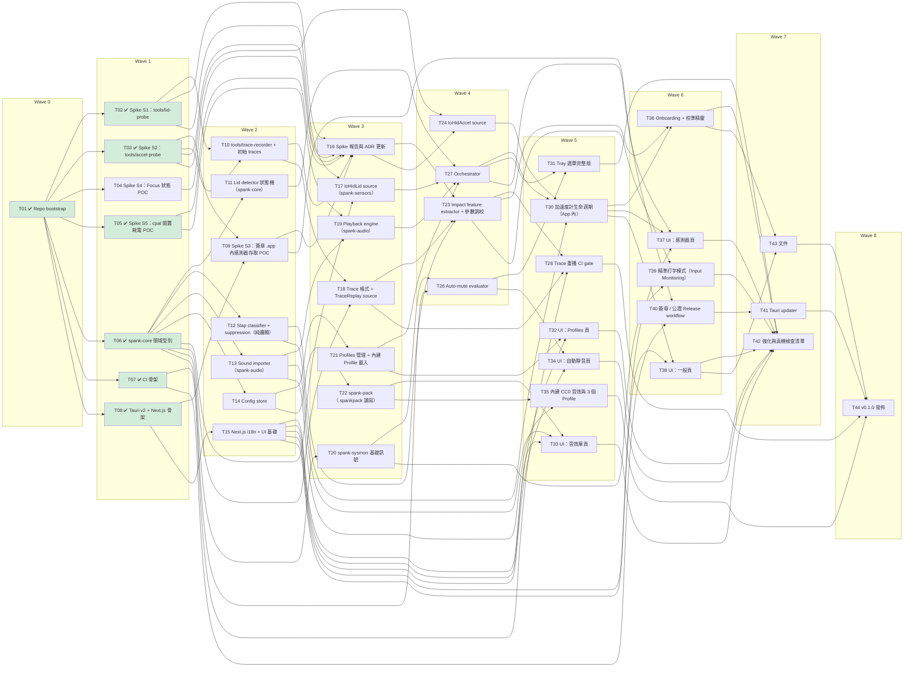

# spank — 任務清單（Phase 1，依 Wave 執行）

> 規則：**同一個 Wave 內的任務彼此沒有依賴，可以平行執行**；每個任務只依賴更早 Wave 的任務。
> 一個 Wave 全部完成（或其依賴的任務完成）後即可開始下一個 Wave。
> ⛳ = Gate：結果可能修改 ADR / 設計，後續任務開始前要先檢查。

## 總覽

| Wave | 主題 | 任務（同 Wave 可平行） |
|------|------|------|
| 0 | Repo 初始化 | T01 ✅ |
| 1 | Spike + 基礎骨架 | T02 ✅ T03 ✅ T04 T05 ✅ T06 ✅ T07 ✅ T08 ✅ |
| 2 | Spike 收尾 + 純邏輯模組 | T09 T10 T11 T12 T13 T14 T15 |
| 3 | ⛳ Spike Gate + 平台層 | T16 T17 T18 T19 T20 T21 T22 |
| 4 | 偵測 / 規則 / Orchestrator | T23 T24 T26 T27 |
| 5 | 感測整合、UI 頁面、CI gate | T28 T30 T31 T32 T33 T34 T35 |
| 6 | Onboarding、進階功能、發佈管線 | T36 T37 T38 T39 T40 |
| 7 | 更新、強化、文件 | T41 T42 T43 |
| 8 | 發佈 | T44 |

> T25（spank-ipc）、T29（spank-helper）已依 ADR-0014 移除（加速度計不需 root）。

**Critical path**：T01 → T03 → T09 → T16 → T24 → T30 → T36 → T43 → T44

### 依賴表

| 任務 | Wave | 依賴 |
|------|------|------|
| T01 ✅ Repo bootstrap | 0 | — |
| T02 ✅ Spike S1：tools/lid-probe | 1 | T01 |
| T03 ✅ Spike S2：tools/accel-probe | 1 | T01 |
| T04 Spike S4：Focus 狀態 POC | 1 | T01 |
| T05 ✅ Spike S5：cpal 閒置耗電 POC | 1 | T01 |
| T06 ✅ spank-core 領域型別 | 1 | T01 |
| T07 ✅ CI 骨架 | 1 | T01 |
| T08 ✅ Tauri v2 + Next.js 骨架 | 1 | T01 |
| T09 Spike S3：簽章 .app 內感測器存取 POC | 2 | T03, T08 |
| T10 tools/trace-recorder + 初始 traces | 2 | T02, T03 |
| T11 Lid detector 狀態機（spank-core） | 2 | T06 |
| T12 Slap classifier + suppression（純邏輯） | 2 | T06 |
| T13 Sound importer（spank-audio） | 2 | T06 |
| T14 Config store | 2 | T06 |
| T15 Next.js i18n + UI 基礎 | 2 | T08 |
| T16 Spike 報告與 ADR 更新 | 3 | T02, T03, T04, T05, T09, T10 |
| T17 IoHidLid source（spank-sensors） | 3 | T02, T06 |
| T18 Trace 格式 + TraceReplay source | 3 | T06, T10 |
| T19 Playback engine（spank-audio） | 3 | T05, T13 |
| T20 spank-sysmon 基礎訊號 | 3 | T06 |
| T21 Profiles 管理 + 內建 Profile 載入 | 3 | T14 |
| T22 spank-pack（.spankpack 讀寫） | 3 | T14 |
| T23 Impact feature extractor + 參數調校 | 4 | T12, T16, T18 |
| T24 IoHidAccel source | 4 | T16, T03 |
| T26 Auto-mute evaluator | 4 | T20, T06 |
| T27 Orchestrator | 4 | T11, T17, T19, T21 |
| T28 Trace 重播 CI gate | 5 | T23, T18, T07 |
| T30 加速度計生命週期（App 內） | 5 | T12, T24, T27 |
| T31 Tray 選單完整版 | 5 | T27, T26 |
| T32 UI：Profiles 頁 | 5 | T21, T15 |
| T33 UI：音效庫頁 | 5 | T13, T22, T15 |
| T34 UI：自動靜音頁 | 5 | T26, T15 |
| T35 內建 CC0 音效與 3 個 Profile | 5 | T13, T22 |
| T36 Onboarding + 校準精靈 | 6 | T23, T30 |
| T37 UI：感測器頁 | 6 | T27, T30, T15 |
| T38 UI：一般頁 | 6 | T30, T15 |
| T39 精準打字模式（Input Monitoring） | 6 | T23, T20 |
| T40 簽章 / 公證 Release workflow | 6 | T09, T07 |
| T41 Tauri updater | 7 | T40 |
| T42 強化與真機檢查清單 | 7 | T31, T32, T33, T34, T36, T37, T38, T39 |
| T43 文件 | 7 | T36, T38 |
| T44 v0.1.0 發佈 | 8 | T41, T43, T35, T28 |

---

## Wave 0 — Repo 初始化

### T01 Repo bootstrap
- 依賴：—
- 狀態：✅ 完成（2026-10-24）：workspace、LICENSE、README、rust-toolchain、rustfmt、.editorconfig、pre-commit（fmt + clippy）、個人 git 身分
- 內容：`git-user personal`；`.gitignore`（target、node_modules、.next、out、`.claude/worktrees`、`*.trace.ndjson` 大檔走 LFS）；
  `LICENSE`（MIT）；`README.md`；根 `Cargo.toml` workspace；`rust-toolchain.toml`（stable）；`.editorconfig`；pre-commit（fmt/clippy）。
- 完成條件：`cargo build --workspace` 通過（空 workspace + tools）；git author 為個人帳號。

## Wave 1 — Spike + 基礎骨架

### T02 Spike S1：`tools/lid-probe`
- 依賴：T01
- 狀態：✅ 完成（2026-10-24，見 spike-report S1）
- 內容：列出 `05AC:8104` 各 collection；開啟 page `0x20`/usage `0x8A`；嘗試 feature report / input report；一般權限執行；印出角度與時間戳；量測更新頻率、是否主動推送。
- 完成條件：`docs/spike-report.md` S1 段落：可否非 root 讀取、報告格式、建議取樣方式。

### T03 Spike S2：`tools/accel-probe`
- 依賴：T01
- 狀態：✅ 完成（2026-10-24，見 spike-report S2；不需 root → ADR-0014）
- 內容：找 page `0xFF00`/usage `3`；一般權限 vs `sudo` 各試一次（含設定 `SensorPropertyReportingState` 等 property）；dump 原始 report hex；推導 x/y/z offset 與單位；量測取樣率；`--ndjson` 輸出樣本。
- 完成條件：spike report S2 段落：是否需 root、格式、取樣率、靜置雜訊、拍打峰值範例。

### T04 Spike S4：Focus 狀態 POC
- 依賴：T01
- 狀態：⚠️ 部分完成（2026-10-24）：授權可取得，但 ad-hoc 簽章下 isFocused 不隨勿擾變化 → 併入 T09 以 Developer ID + entitlement 重測（見 spike-report S4）
- 內容：Rust + objc2 呼叫 `INFocusStatusCenter`，請求授權並讀 `isFocused`（需在 .app bundle 內執行）。
- 完成條件：spike report S4：可行 / 不可行 + 需要的 Info.plist key。

### T05 Spike S5：cpal 閒置耗電 POC
- 依賴：T01
- 狀態：✅ 完成（2026-10-24）：stream 建立後保持 paused、按需 play（見 spike-report S5）
- 內容：常駐 output stream（輸出靜音）vs 按需開 stream；量測 CPU / 能源影響與首音延遲。
- 完成條件：spike report S5：選定策略。

### T06 `spank-core` 領域型別
- 依賴：T01
- 狀態：✅ 完成（2026-10-24）：20 個單元測試，line coverage 98.7%
- 內容：`EventKind`、`TriggerEvent`、`Profile`、`EventBinding`、`LidConfig`、`SlapConfig`、`MuteRules`、`Priority`；serde；預設值。
- 完成條件：單元測試覆蓋 serde round-trip 與預設值。

### T07 CI 骨架
- 依賴：T01
- 狀態：✅ 完成（2026-10-24）：`.github/workflows/ci.yml` + `deny.toml`；本機 fmt / clippy / test / llvm-cov / cargo-deny 皆通過（尚無 remote，未在 GitHub 上跑過）
- 內容：`.github/workflows/ci.yml`：fmt、clippy `-D warnings`、test、`cargo llvm-cov`（先不設門檻）、`cargo deny`；pnpm lint/test（UI 建好後啟用）。
- 完成條件：PR 上 CI 綠燈。

### T08 Tauri v2 + Next.js 骨架
- 依賴：T01
- 狀態：✅ 完成（2026-10-24）：tray-only 12 MB、Dock 圖示隨設定視窗出現 / 消失（見 spike-report T08）。登入時啟動外掛已註冊，實際啟用交給 T14 / T38
- 內容：`apps/desktop`：Tauri v2、Next.js `output: "export"`、TypeScript、pnpm；tray icon + 基本選單（設定…、結束）；`LSUIElement`；關閉視窗即銷毀 WebView、ActivationPolicy 切換；login item（`tauri-plugin-autostart` 或 SMAppService mainApp）。
- 完成條件：`pnpm tauri dev` 可跑；關閉視窗後 Dock 圖示消失、tray 仍在；閒置記憶體記錄於 spike report。

## Wave 2 — Spike 收尾 + 純邏輯模組

### T09 Spike S3：簽章 .app 內感測器存取 POC
- 依賴：T03、T08
- 內容：在 T08 的 Tauri App 內（ad-hoc 與 Developer ID 簽章、Hardened Runtime 開啟）重跑 lid 輪詢與加速度計讀取；以 Developer ID + Communication Notifications entitlement 重測 Focus `isFocused`（T04 未完成部分）；從 Finder 雙擊與登入項目啟動各測一次（排除 Terminal 繼承的權限）；確認是否需要任何 entitlement 或 TCC 提示。
- 完成條件：spike report S3；ADR-0014 狀態改為 Accepted（或退回 ADR-0003 helper 備案）。

### T10 `tools/trace-recorder` + 初始 traces
- 依賴：T02、T03
- 內容：同時錄 lid + accel 到 NDJSON（ADR-0010 格式）；鍵盤快捷鍵即時標註；錄製場景：靜置、打字、觸控板、輕/中/重拍、連拍、開合、掰過頭、放桌上、走路攜帶、播放音樂。
- 狀態：部分完成 — `fixtures/traces/spike-m4air-01`（9 個標註片段：靜置、打字、觸控板、輕/中/重拍、連拍、開合）。尚缺：放桌上、走路攜帶、喇叭播放音樂、掰過頭、外接鍵盤。
- 完成條件：`fixtures/traces/` 至少 10 段標註 trace。

### T11 Lid detector 狀態機（`spank-core`）
- 依賴：T06
- 內容：design §4.1；hysteresis、cooldown、`lid_moving` 旗標、wake 事件處理。
- 完成條件：以合成資料單元測試所有轉換與邊界。

### T12 Slap classifier + suppression（純邏輯）
- 依賴：T06
- 內容：design §4.2 第 2–3 步：分級、連擊、cooldown、各 suppression gate（輸入為 `ImpactCandidate` 與 gate 訊號）。
- 完成條件：合成資料單元測試；門檻參數先用 placeholder。

### T13 Sound importer（`spank-audio`）
- 依賴：T06
- 內容：symphonia decode、rubato resample、去前導靜音、ebur128 正規化、true-peak 限制、長度/大小限制、WAV 輸出、sha256。
- 完成條件：各格式 fixture 測試；輸出響度 -16 ± 0.5 LUFS。

### T14 Config store
- 依賴：T06
- 內容：design §9 目錄結構；atomic write；schema version + migration 框架；sound library index CRUD。
- 完成條件：單元測試（temp dir）；毀損檔案時回復預設並備份。

### T15 Next.js i18n + UI 基礎
- 依賴：T08
- 內容：`next-intl`（zh-Hant / en，跟隨系統語言）；layout、導覽、設計 token；`tauri-specta` 型別產生流程。
- 完成條件：切換系統語言 UI 跟著變；Vitest 跑得起來。

## Wave 3 — ⛳ Spike Gate + 平台層

### T16 ⛳ Spike 報告與 ADR 更新
- 依賴：T02、T03、T04、T05、T09、T10
- 內容：彙整 `docs/spike-report.md`；更新 ADR-0003（Accepted 或 Superseded）、ADR-0005 取樣方式、ADR-0006 參數初值、ADR-0007 Focus 可行性；必要時調整本任務清單。
- 狀態：S1、S2 已完成並更新 ADR（0003 → 0014、0005、0006）；等待 S3、S4、S5。
- 完成條件：使用者審閱同意。

### T17 `IoHidLid` source（`spank-sensors`）
- 依賴：T02、T06
- 內容：依 S1 結果實作 `LidSource`；capability detection；sleep 時停止。
- 完成條件：真機手動驗證；解析函式單元測試。

### T18 Trace 格式 + `TraceReplay` source
- 依賴：T06、T10
- 內容：NDJSON reader/writer、labels；`TraceReplay` 實作 `LidSource` / `AccelSource`，可加速重播。
- 完成條件：讀取 T10 的 traces 並重播測試。

### T19 Playback engine（`spank-audio`）
- 依賴：T05、T13
- 內容：cpal 輸出、單聲部 mixer、優先權中斷 + 50 ms fade-out、預載、gain 計算、`self_playing` 訊號輸出。
- 完成條件：單元測試（mixer 邏輯以假 output）；真機延遲 < 50 ms。

### T20 `spank-sysmon` 基礎訊號
- 依賴：T06
- 內容：sleep/wake、screen lock、mic in-use、camera in-use、系統音量/靜音（以 listener 為主，避免輪詢）。
- 完成條件：真機手動驗證每個訊號；輸出 `SysSignal` 事件流。

### T21 Profiles 管理 + 內建 Profile 載入
- 依賴：T14
- 內容：Profile CRUD、複製、刪除、內建唯讀、active profile、隨機挑音（避免連續重複）。
- 完成條件：單元測試。

### T22 `spank-pack`（.spankpack 讀寫）
- 依賴：T14
- 內容：ADR-0009 manifest schema、驗證（sha256、大小、路徑穿越、zip bomb）、匯入建立 Profile、匯出。
- 完成條件：單元測試 + `cargo fuzz` target。

## Wave 4 — 偵測 / 規則 / Orchestrator

### T23 Impact feature extractor + 參數調校
- 依賴：T12、T16、T18
- 內容：design §4.2 第 1 步（高通、noise floor、開窗、特徵）；打字訊號特徵濾波；用 traces 調參數。
- 完成條件：trace 重播 precision ≥ 0.95、recall ≥ 0.90。

### T24 `IoHidAccel` source
- 依賴：T16、T03
- 內容：依 S2 結果實作 `AccelSource`：sensor thread + CFRunLoop、property 設定 / 還原（含啟動時重設 crash 殘留）、callback 只寫 SPSC ring buffer 且不可 panic、批次讀取、停止/啟動。
- 完成條件：真機驗證；解析函式單元測試。

### T26 Auto-mute evaluator
- 依賴：T20、T06
- 內容：四條規則合成、quiet hours（跨午夜、多段）、靜音原因輸出。（Focus 規則依 T04 結果接入或標記不支援）
- 完成條件：單元測試（時間以可注入 clock）。

### T27 Orchestrator
- 依賴：T11、T17、T19、T21
- 內容：design §4.3；串接 lid detector → profile → playback；pause/resume；sleep/lock 時停止感測器。
- 完成條件：用 `TraceReplay` 的整合測試：重播開合 trace 觸發正確事件序列。

## Wave 5 — 感測整合、UI 頁面、CI gate

### T28 Trace 重播 CI gate
- 依賴：T23、T18、T07
- 內容：CI 跑所有 trace 計算 precision/recall，低於門檻失敗；覆蓋率門檻設 80%。
- 完成條件：CI 綠燈且有報表輸出。

### T30 加速度計生命週期（App 內）
- 依賴：T12、T24、T27
- 內容：啟用 / 停用拍打、暫停 / 鎖定 / 睡眠時停止感測器、capability detection（property 失敗或無報告 → 標示不支援）、將 `ImpactCandidate` 接入 suppression → classifier → orchestrator。
- 完成條件：`TraceReplay` 整合測試：重播拍打 trace 觸發正確事件序列；真機端到端於 T36 驗證。

### T31 Tray 選單完整版
- 依賴：T27、T26
- 內容：design §10.1；狀態 / 靜音原因顯示、Profile 切換、試聽、暫停。
- 完成條件：手動驗證。

### T32 UI：Profiles 頁
- 依賴：T21、T15
- 內容：Profile 清單、事件對應編輯、拖放音效、試聽、啟用開關、音量。
- 完成條件：Vitest 元件測試 + 手動驗證。

### T33 UI：音效庫頁
- 依賴：T13、T22、T15
- 內容：拖放 / 選檔上傳、進度與錯誤訊息、波形預覽、改名、刪除、匯入 / 匯出 `.spankpack`。
- 完成條件：Vitest + 手動驗證。

### T34 UI：自動靜音頁
- 依賴：T26、T15
- 內容：四條規則開關、安靜時段編輯器、Focus 權限請求流程。
- 完成條件：Vitest + 手動驗證。

### T35 內建 CC0 音效與 3 個 Profile
- 依賴：T13、T22（以 `.spankpack` 形式打包內建音效）
- 內容：挑選 CC0 音源、經 importer 正規化、`SOUNDS_LICENSE.md` 記錄來源、組成「毀滅」「哀哀叫」「經典」三個 Profile，總計 < 5 MB。
- 完成條件：bundle 內含並在首次啟動載入。

## Wave 6 — Onboarding、進階功能、發佈管線

### T36 Onboarding + 校準精靈
- 依賴：T23、T30
- 內容：design §11（不需管理員密碼 / 系統設定核准）；輕/中/重 + 打字 5 秒；寫 `calibration.json`；可重新校準。
- 完成條件：全新使用者帳號上手動走完流程；真機端到端：拍打 → 哀叫。

### T37 UI：感測器頁
- 依賴：T27、T30、T15
- 內容：即時角度、門檻滑桿、拍打靈敏度、重新校準、精準打字模式開關、能力狀態。
- 完成條件：手動驗證。

### T38 UI：一般頁
- 依賴：T30、T15
- 內容：登入時啟動、App 音量、語言、複製診斷資訊、log 位置。
- 完成條件：手動驗證。

### T39 精準打字模式（Input Monitoring）
- 依賴：T23、T20
- 內容：IOHIDManager 監聽鍵盤 / 觸控板活動（只取「有輸入」時間戳，不記錄按鍵內容）；權限請求；接入 suppression gate。
- 完成條件：權限拒絕時自動退回訊號濾波。

### T40 簽章 / 公證 Release workflow
- 依賴：T09、T07
- 內容：`release.yml`：Developer ID 簽章、hardened runtime、entitlements、`notarytool`、`stapler`、DMG、GitHub Release；Secrets 文件化。
- 完成條件：tag 產出可在乾淨機器上安裝、無 Gatekeeper 警告的 DMG。

## Wave 7 — 更新、強化、文件

### T41 Tauri updater
- 依賴：T40
- 內容：簽章 `latest.json`、每日檢查、詢問更新。
- 完成條件：v0.0.x → v0.0.y 自動更新成功。

### T42 強化與真機檢查清單
- 依賴：T31、T32、T33、T34、T36、T37、T38、T39
- 內容：`docs/release-checklist.md`；功耗觀察（ADR-0013）；錯誤處理與 log；fuzz 跑一輪；無障礙基本檢查。
- 完成條件：checklist 全數通過。

### T43 文件
- 依賴：T36、T38
- 內容：README（安裝、權限說明、FAQ、支援機型）、CONTRIBUTING（如何貢獻 trace / 音效包）、隱私說明。
- 完成條件：審閱通過。

## Wave 8 — 發佈

### T44 v0.1.0 發佈
- 依賴：T41、T43、T35、T28
- 內容：決定正式產品名稱與 bundle ID（ADR-0012）→ 替換 → tag → release。
- 完成條件：DMG 發佈於 GitHub Releases。
